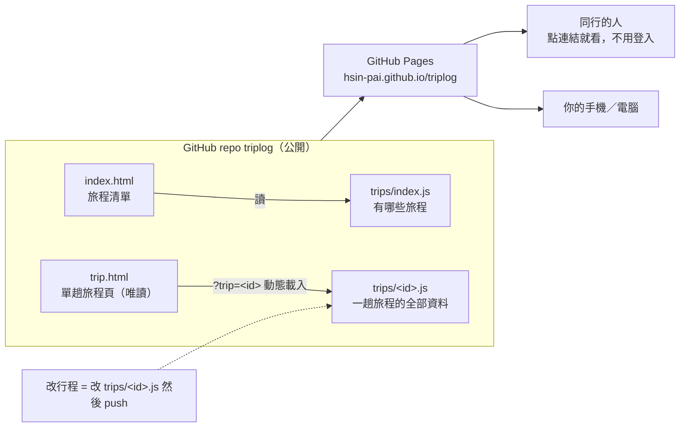

# 🧳 TripLog 旅程

把每一趟出去玩的**逐日行程、住宿費用、出發前待辦、還沒定案的事**放在同一個網站上。純靜態 HTML + JS，沒有後端、沒有 build、沒有帳號，放在 GitHub Pages 上，**連結丟給同行的人就能看，對方不用登入任何東西**。

一個 repo 放所有旅程，每趟旅程一個資料檔。改行程就是改那個檔案。

## 為什麼這樣做

之前試過把行程放在需要登入才能看的共編工具，結果同行的人只有公司帳號、不方便拿來處理私人行程。靜態網站沒有這個問題：連結就是一切。代價是對方不能直接線上改，意見用 LINE 傳回來、由維護的人改資料檔就好。

## 系統架構



- `trip.html?trip=hokkaido-2026` 會動態載入 `trips/hokkaido-2026.js`，所以**新增旅程不用動任何 HTML**。
- 資料檔是 `window.TRIP = {...}` 的 JS，不是 JSON，這樣直接雙擊 HTML 在本機開也能看（JSON 用 `fetch` 在 `file://` 下會被瀏覽器擋）。

## 旅程資料檔格式

`trips/<id>.js`：

```js
window.TRIP = {
  id: "hokkaido-2026",
  title: "北海道 9 天 8 夜",
  range: "2026/11/30（一）– 12/08（二）",
  mode: "一句話說明行程模式",
  travelers: 2,              // 住宿「每人」金額用這個除
  updated: "2026-10-26",

  days: [
    { n: 1, date: "11/30", weekday: "一", place: "函館", leg: "rail",   // place 顯示在路線圖站名；leg = rail 鐵路 | drive 自駕 | city 市區（決定線段顏色）
      title: "這天的主題", transport: "這天的交通方式",
      items: [
        { time: "14:05", kind: "move", text: "做什麼", url: "https://maps.google.com/?cid=…" }
        //  kind：move 移動 | see 景點 | eat 吃 | lit 點燈 | stay 住宿 | warn 提醒
        //  url 選填，會變成「地圖 ↗」小連結
        ,
        // 移動也可以寫成「乘車券」：有 from/to 就畫成卡片，其他欄位全選填
        { time: "16:19", kind: "move", mode: "rail", from: "南千歲", to: "函館", via: "JR 特急北斗 18 號", arr: "19:29", dur: "3 小時 10 分",
          board: "在哪上車：幾樓、幾番線、怎麼走到月台（會加粗）", alight: "下車後怎麼走",
          fare: "票價", ticket: "怎麼買、何時開賣（未 booked 時顯示「待訂」）", note: "備案", booked: false }
        //  mode：fly 飛機 | rail 鐵路 | drive 自駕 | taxi | bus | walk，只影響圖示
        //  url：移動一律連「目的地」，其他項目連該地點，一律用 Google 唯一地點連結 https://maps.google.com/?cid=…；boardUrl 只在上車處和上一項不同時填
        //  routeUrl：移動選填，Google 路線連結（起點座標 → 終點座標），會變成「路線 ↗」
      ] }
  ],
  stays: [ { name, checkin, checkout, nights, price, area, note, url } ],   // price 單位 TWD
  todos: [ { cat: "分類", text: "事項", done: false } ],
  notes: [ { by: "誰", at: "2026/10/26", text: "還沒定案的事" } ]
};
```

順序就是陣列順序，想調整直接搬行。

## 新增一趟旅程

1. 複製 `trips/hokkaido-2026.js` 成 `trips/<新id>.js`，改內容
2. 在 `trips/index.js` 的 `TRIPS` 陣列加一筆 `{ id, title, range, summary, status }`
3. push，首頁就會出現

## 本機預覽

直接雙擊 `index.html` 就能開。

## 部署到 GitHub Pages（只做一次）

1. 在 GitHub 建公開 repo `triplog`，把這個資料夾 push 上去（branch `main`）
2. repo 的 **Settings → Pages → Build and deployment**：Source 選 **Deploy from a branch**，Branch 選 `main` / `/ (root)`，Save
3. 等一兩分鐘，網址就是 `https://hsin-pai.github.io/triplog/`
4. 之後每次 push，頁面自動更新

分享單趟旅程用 `https://hsin-pai.github.io/triplog/trip.html?trip=<id>`。

## 作者

**Hsin Pai**（[@HSIN-PAI](https://github.com/HSIN-PAI)）
